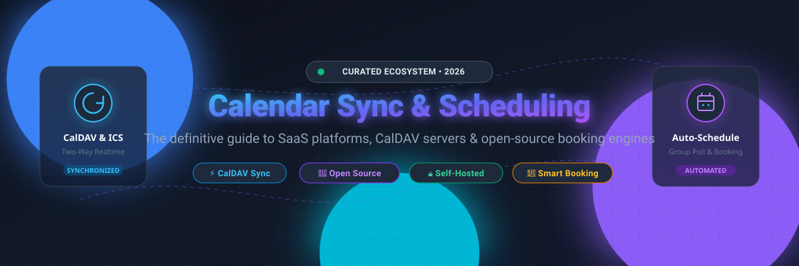
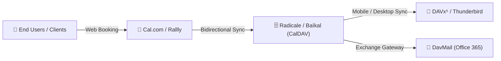

# 📅 Awesome Calendar Synchronization &amp; Scheduling ⚡

**The ultimate curated collection of enterprise SaaS platforms, CalDAV servers, self-hosted appointment booking engines, and meeting poll synchronization utilities.**

✨ Find the best open-source alternatives to Calendly, Doodle, and Google Calendar for seamless availability sync, automated workflows, and complete data sovereignty. ✨

---

## 📌 Table of Contents

- [🌐 Sector Overview &amp; Market Dynamics](#-sector-overview--market-dynamics)
- [💼 SaaS &amp; Hosted Platforms](#-saas--hosted-platforms)
- [🔓 Open-Source GitHub Projects](#-open-source-github-projects)
  - [🚀 Top Self-Hosted Schedulers &amp; Sync Engines](#-top-self-hosted-schedulers--sync-engines)
  - [🛠️ Protocol Frameworks &amp; Gateways](#️-protocol-frameworks--gateways)
- [🏗️ Recommended Architecture &amp; System Stacks](#️-recommended-architecture--system-stacks)
- [🤝 How to Contribute](#-how-to-contribute)
- [💖 Support](#-support)
- [⭐ Star History](#-star-history)
- [⚖️ Disclaimer](#️-disclaimer)

---

## 🌐 Sector Overview &amp; Market Dynamics

The global **appointment scheduling and calendar synchronization software** market is valued at approximately **$0.6B–$1.5B** (projected to exceed **$3.5B+** when factoring in field service, workforce management, and enterprise CRM calendar connectors), expanding at a rapid **10%–14% CAGR**.

### 🔍 Market Fragmentation vs. Concentration
The industry exhibits **moderate-to-high fragmentation**:
- **Core Infrastructure Layer:** Heavily consolidated around tech titans (Microsoft 365 Exchange and Google Workspace), which provide foundational calendar storage and user authentication.
- **Workflow &amp; Application Layer:** Highly fragmented across hundreds of specialized SaaS solutions, self-hosted platforms, and point tools. Because scheduling workflows vary wildly across industries (e.g., healthcare HIPAA compliance, sales routing, high-volume group polling, freelancer booking), there is no single winner-take-all monopoly. Open-source CalDAV servers and self-hosted booking platforms continue to capture market share among privacy-focused organizations seeking data ownership.

---

## 💼 SaaS &amp; Hosted Platforms

| Company / Product | Company Size (Revenue / Valuation) | Pricing (Starting Tier) | Free Tier Limits | Description |
| :--- | :--- | :--- | :--- | :--- |
| **[Microsoft Outlook Sync](https://www.microsoft.com/en-us/microsoft-365/outlook/)** 🏢 | ~$3.1T Market Cap (~$245B ARR / Revenue) | $6.00/user/month (Microsoft 365 Business Basic, annual commitment) | Free forever personal account via Outlook.com (free web/mobile app, 15 GB mailbox storage, 5 GB OneDrive cloud storage; Microsoft Bookings & custom domains require paid 365 license) | Microsoft's enterprise calendar & email client with Exchange ActiveSync, Microsoft 365 shared calendars, Teams integration, and customer-facing scheduling pages via Microsoft Bookings. |
| **[Google Calendar Sync](https://calendar.google.com/)** 🌍 | ~$2.1T Market Cap (~$350B Revenue) | $6.00/user/month (Google Workspace Business Starter, annual commitment) | Free forever personal Google account (includes 15 GB shared Google Drive/Gmail storage, unlimited events/calendars, basic single booking page; multi-appointment schedules & payment collection require Workspace) | Native calendar service with two-way sync across Android, iOS, web, and third-party apps; supports shared team calendars, appointment booking slots, and Google Meet integration. |
| **[Cron (now Notion Calendar)](https://cron.com/)** ⚡ | ~$11B Valuation (~$600M ARR) | $10.00/seat/month (Notion Plus plan, billed annually) | Free forever standalone calendar app (connects multiple Google Calendars, unlimited 1:1 scheduling links; workspace database limits follow Notion Free plan: unlimited blocks for solo users, 1,000 blocks cap for teams of 2+ members, 5 MB file upload limit) | Keyboard-driven calendar application designed for speed, multi-account overlay, global time zone coordination, and bidirectional sync with Notion databases. |
| **[Freshworks Calendar Sync](https://www.freshworks.com/)** 📈 | ~$3.5B Market Cap (~$965M ARR) | $9.00/user/month (Freshsales Growth tier, billed annually) | Free forever plan for up to 3 users (includes 2-way Google Calendar and Outlook/Microsoft 365 sync, contact management, capped at 1,000 API requests/hour; 21-day full-feature trial for paid tiers) | Unified CRM calendar integration linking sales and service pipelines directly to Google and Microsoft Outlook schedules for automated activity logging. |
| **[Calendly](https://calendly.com/)** 🎯 | ~$3.0B Valuation (~$350M ARR) | $10.00/seat/month (Standard tier, billed annually) | Free forever plan: 1 user, 1 connected calendar account, 1 active event type rule, unlimited 1-on-1 bookings, basic automated notifications (no automated SMS, group/round-robin events, or payment gateways; 14-day free trial of Teams tier) | Category-leading scheduling automation platform eliminating back-and-forth emails; automates routing, multi-person availability, and cross-platform integrations. |
| **[Acuity Scheduling](https://acuityscheduling.com/)** 🛒 | Subsidiary of Squarespace (Acquired for ~$100M+; Squarespace taken private at ~$7.2B) | $16.00/month (Starter tier, billed annually) | No free forever plan; 7-day free trial (extended to 14 days when bundled with a Squarespace website trial; includes 1 calendar and full scheduling features without requiring a credit card) | Appointment scheduling platform optimized for service businesses, client self-scheduling, intake questionnaires, recurring memberships/subscriptions, and payment processing. |
| **[Chili Piper](https://www.chilipiper.com/)** 🔥 | ~$625M Valuation (~$45M–$50M ARR) | $15.00/user/month (ChiliCal Standalone, billed annually; Growth tier starts at $15,000/year base) | No free forever plan and no public self-serve free trial; access requires a live enterprise sales demo and annual contract agreement | Inbound conversion and routing scheduling software for B2B revenue teams; features automated instant booking directly from web forms and round-robin CRM assignment. |
| **[Cirrus Insight](https://www.cirrusinsight.com/)** 📊 | ~$15M–$25M Estimated Valuation (~$8M–$12M ARR; Private Equity owned) | $11.00/user/month (Salesforce Sidebar & Calendar Sync module, billed annually) | No free forever plan; 14-day free trial with full access to sidebar CRM tracking, calendar sync, and email sequence testing | Sales enablement and calendar sync platform natively integrating Microsoft 365 and Google Calendar with Salesforce and CRM records. |
| **[Doodle](https://doodle.com/)** 🗳️ | Subsidiary of TX Group (~$1.1B Market Cap; Doodle standalone ARR ~$15M–$25M) | $6.95/user/month (Pro tier, billed annually) | Free forever plan: 1 user, 1 active group poll, 1 booking page, 1 sign-up sheet, ad-supported interface (no custom branding, automated reminders, or calendar-sync detection; 14-day Pro free trial) | Popular group meeting poll and consensus scheduling tool enabling participants to vote on ideal time windows across different calendars without an account. |
| **[YouCanBookMe](https://youcanbook.me/)** ⏱️ | ~$15M–$25M Estimated Valuation (Bootstrapped, ~$5M ARR) | $9.00/month (Individual tier, billed annually) | Free forever plan: 1 calendar connection, 1 booking page, capped at 30 bookings per month, includes YouCanBookMe branding (14-day unlimited free trial of paid features) | Intuitive booking system with buffer times, configurable question forms, time zone conversion, and video conferencing sync. |

---

## 🔓 Open-Source GitHub Projects

Sorted by GitHub_Stars in descending order. Every badge links directly to the project's stargazers page.

### 🚀 Top Self-Hosted Schedulers &amp; Sync Engines

1. **[Cal.com](https://github.com/calcom/cal.com)**  🌟  
   The leading open-source scheduling infrastructure and Calendly alternative. Features advanced round-robin team routing, embeddable booking widgets, webhook automation, app store integrations (Zoom, Google Meet, Stripe), and comprehensive self-hosting via Docker and Kubernetes.

2. **[Nextcloud Server](https://github.com/nextcloud/server)**  ☁️  
   Self-hosted productivity platform providing full CalDAV and CardDAV synchronization services, shared calendars, file sync, and native collaboration for millions of privacy-conscious enterprise users.

3. **[Stalwart Mail &amp; Collaboration Server](https://github.com/stalwartlabs/mail-server)**  🛡️  
   Modern, secure, and all-in-one mail, calendar, and contacts server written in Rust. Features native support for CalDAV, CardDAV, JMAP, IMAP, and SMTP with zero external runtime dependencies.

4. **[Rallly](https://github.com/lukevella/rallly)**  🗳️  
   Open-source Doodle alternative for collaborative meeting polls and consensus scheduling. Allows attendees to vote on preferred time slots without account registration. Built with Next.js, Prisma, and tRPC with Docker deployment.

5. **[Radicale](https://github.com/Kozea/Radicale)**  🍃  
   Lightweight CalDAV (calendar) and CardDAV (contacts) server in Python with minimal administrative overhead. Stores items as plain text files on disk with built-in Git backup support and authentication hooks.

6. **[Easy!Appointments](https://github.com/alextselegidis/easyappointments)**  📅  
   Highly customizable open-source appointment scheduler built with PHP and MySQL. Provides public booking pages, multi-provider calendar synchronization with Google Calendar, and email notification workflows.

7. **[Baïkal](https://github.com/sabre-io/Baikal)**  🏛️  
   Lightweight CalDAV and CardDAV server powered by sabre/dav. Offers a clean web-based administration panel for managing multiple users, address books, and shared calendar collections over SQLite or MySQL.

8. **[khal](https://github.com/pimutils/khal)**  💻  
   CLI and terminal-based calendar application for power users. Seamlessly displays, adds, and edits events stored in local Maildir/vdir directories, syncing remotely via vdirsyncer.

9. **[DAVx⁵](https://github.com/bitfireAT/davx5-ose)**  📱  
   All-in-one CalDAV and CardDAV synchronization solution for Android. Connects mobile calendars and address books to Nextcloud, Radicale, Baïkal, Fastmail, or any RFC-compliant CalDAV backend.

10. **[Open Event Server (Eventyay)](https://github.com/fossasia/open-event-server)**  🎪  
    FOSSASIA's event management and multi-track scheduling platform with REST APIs, ticketing, scheduling matrices, and calendar export capabilities (iCal/ICS).

11. **[vdirsyncer](https://github.com/pimutils/vdirsyncer)**  🔄  
    Command-line command engine to synchronize calendars (CalDAV) and contacts (CardDAV) between multiple remote servers or local directories with bidirectional conflict resolution.

12. **[Nextcloud Calendar](https://github.com/nextcloud/calendar)**  🗓️  
    The official calendar interface for Nextcloud. Features attendee invitations, free/busy status visibility, appointment booking slots, room resource reservations, and seamless CalDAV synchronization.

13. **[DavMail](https://github.com/mguessan/davmail)**  🚪  
    POP/IMAP/SMTP/CalDAV/CardDAV gateway allowing standard open-source calendar clients (Thunderbird, Evolution, iOS) to synchronize with Microsoft Exchange and Office 365 behind corporate firewalls.

14. **[Davis](https://github.com/tchapi/davis)**  🎛️  
    Modern, Docker-ready administrative interface for sabre/dav built with Symfony and Bootstrap. Enables rapid self-hosted CalDAV/CardDAV account and resource administration.

15. **[Xandikos](https://github.com/jelmer/xandikos)**  🗄️  
    Lightweight Python CalDAV/CardDAV server backed directly by a Git repository for complete event versioning, history tracking, and atomic rollbacks.

16. **[Tymeslot](https://github.com/Tymeslot/tymeslot)**  ⏱️  
    Full-featured meeting scheduling system engineered in Elixir and Phoenix LiveView. Supports Google, Apple iCloud, Nextcloud, Radicale, and Zimbra calendar sync, alongside video meeting generation and Stripe payments.

17. **[jawanndenn](https://github.com/hartwork/jawanndenn)**  📊  
    Simple, libre alternative to Doodle polls for date and scheduling consensus. Built with Python, Django, React, and TypeScript with turnkey Docker deployment.

18. **[nexcal](https://github.com/ribato22/nexcal)**  ⚡  
    Lightweight self-hosted Calendly alternative designed for service providers and clinics. Features Google Calendar synchronization, anti-double-booking locks, and payment gateway webhooks using Next.js 16 and PostgreSQL.

---

### 🛠️ Protocol Frameworks &amp; Gateways

- **[sabre/dav](https://github.com/sabre-io/dav)**  🧱 — The battle-tested PHP standard framework powering Baïkal, Nextcloud, and Davis for RFC 4791 CalDAV, CardDAV, and WebDAV endpoints.
- **[potatotime](https://pypi.org/project/potatotime/)** 🐍 — Python library for programmatically synchronizing events and reconciling free/busy state across Google, Outlook, and iCal formats.
- **Musubi** 🤝 — Open-source shared calendar providing two-way sync across Google Calendar, Apple iCloud, Outlook, and CalDAV with self-hosted instances.

---

## 🏗️ Recommended Architecture &amp; System Stacks

For developers and system administrators constructing a completely independent, privacy-first scheduling infrastructure:

- **Storage &amp; Protocol Layer:** Deploy **Radicale** (minimal plain files) or **Baïkal** (SQLite/MySQL) for robust CalDAV/CardDAV services.
- **Appointment Booking &amp; Client Scheduling:** Deploy **Cal.com** or **Easy!Appointments** to provide automated self-serve booking workflows.
- **Group Consensus &amp; Meeting Polls:** Deploy **Rallly** or **jawanndenn** for ad-hoc group voting without forced account registration.
- **Mobile &amp; Edge Sync:** Use **DAVx⁵** on Android and native CalDAV on iOS/macOS connected via SSL/TLS.

---

## 🤝 How to Contribute

Contributions are welcome and actively encouraged! 🚀

1. 🍴 **Fork the repository** to your GitHub account.
2. 🌿 **Create a descriptive feature branch** (`git checkout -b add-scheduling-tool`).
3. 📝 **Add or update entries in `README.md`** following the existing format:
   - Must include name, official link, GitHub Stars_Badge, and an objective description.
   - For SaaS products, include exact pricing and free tier limits in the SaaS table.
4. 🚀 **Submit a Pull Request (PR)** detailing the project added and why it benefits the calendar synchronization ecosystem.

---

## 💖 Support

If you find this curated ecosystem list helpful, please consider showing your support:

- ⭐ **Star this repository** to help others discover it!
- 🍴 **Fork and share** with colleagues, DevOps teams, and productivity enthusiasts.
- ☕ **Buy me a coffee / Sponsor**: Support ongoing maintenance and curation on the [GitHub Sponsors Dashboard](https://github.com/sponsors/ishandutta2007).

Thank you for supporting open source and privacy-first scheduling tools! 🙌

---

## ⭐ Star History

---

## ⚖️ Disclaimer

- This repository is a **community-curated directory** provided for educational and administrative reference—it does not constitute a formal commercial endorsement.
- Calendar and scheduling platforms handle sensitive personal and business availability data. Always evaluate applicable data privacy regulations (GDPR, CCPA, HIPAA) before deploying.
- Self-hosted CalDAV servers should always be deployed behind secure reverse proxies with modern TLS encryption, authentication controls, and regular backup mechanisms.
- Review third-party calendar OAuth integration scopes to follow the principle of least privilege.

---

  Built with ❤️ for privacy enthusiasts, system administrators, and software teams worldwide.

